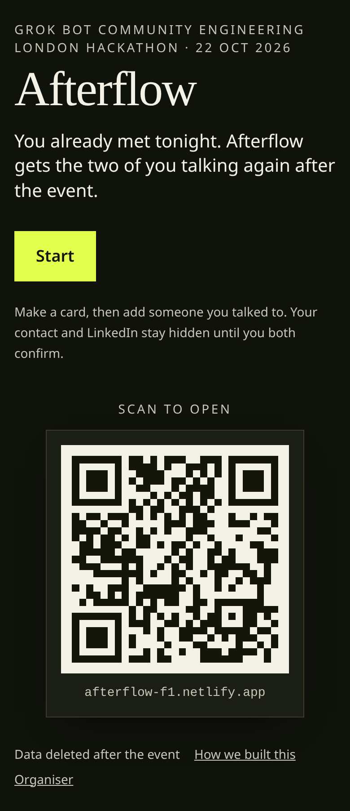
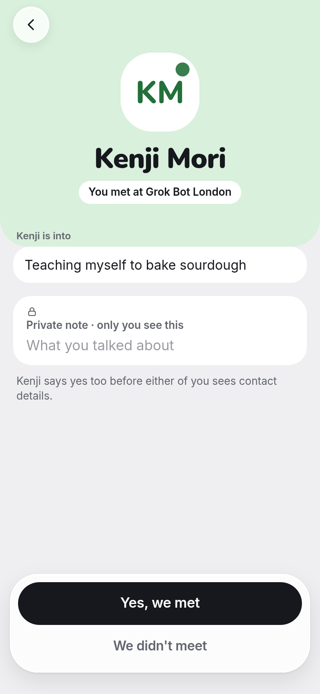
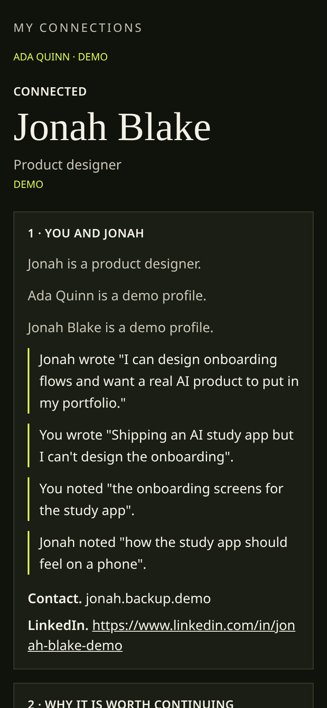

<h1 align="center">Afterflow</h1>

<p align="center">
  <a href="https://afterflow-f1.netlify.app"><strong>Open Afterflow → afterflow-f1.netlify.app</strong></a>
</p>

<p align="center">
  Keep the people you meet in your life.<br>
  <em>Afterflow keeps the door open. You two walk through it.</em>
</p>

<p align="center">
  <a href="https://afterflow-f1.netlify.app">Live app</a> ·
  <a href="https://afterflow-f1.netlify.app/demo">Demo connection</a> ·
  <a href="https://afterflow-f1.netlify.app/how-we-built">How we built it</a> ·
  <a href="#run-it-yourself">Run it yourself</a> ·
  <a href="LICENSE">MIT licence</a>
</p>

<p align="center">
  
  
  
  <a href="LICENSE"></a>
</p>

<p align="center">
  
  
  
</p>

At an event, talking is easy. Afterwards it gets awkward, then it stops. Afterflow is for people who **already met** in real life and want to keep casually talking, so strangers can become familiar and maybe friends. It doesn't match you with strangers, score anyone, or replace the apps you already use. There's no chat, feed or profile browsing inside Afterflow: it gets you talking on the app you already use, faster.

It started at the Grok Bot Community Engineering London Hackathon (22 Oct 2026).

## How it works

1. **Make a card.** Your name, the ways to reach you (any of WhatsApp, Discord, Instagram and email; star the one you like best), and one question: *What's something you're into right now?* That's it.
2. **Show your code.** Someone you just talked to scans your QR code or opens your link and taps **Yes, we met**.
3. **Both say yes.** Your contact only shows once you both confirm. If you don't, nothing happens and nobody is told.
4. **Say hi later.** Each person you met lives in **Your people**. Open them to see what you both said and a note you can both see, then **Say hi** with a ready opener you can change. If you both use an app, that's first ("You both use WhatsApp. Say hi there."); otherwise it's their favourite. WhatsApp opens with the message filled in, email opens a draft, Instagram opens their profile, Discord copies their username.
5. **Keep them by event.** The **Events** tab groups people by where you met. Tap **I'm at an event now** and new people are filed there for 24 hours. Your events are private: filing someone changes nothing for them.
6. **No pressure.** At most one gentle reminder per person, on by default and easy to turn off on My card: in the app, or as one event in your own calendar ("Say hi to Mira", about three days later). "Talked again? Mark it" is just for you. No counts, no streaks.

## Private and quiet

- Your answer shows on your card link. Your contact only shows once you both confirm.
- Your own notes are private. The shared note is visible to both of you.
- **Mute**, **Remove** and **Block** are quiet: the other person is never told. Block also stops them adding you again. There is no public profile, follower count or ranking.
- Your card stays until you remove someone or delete it. **Delete my card** really deletes your card, links and connections.
- Demo people are always labelled **Demo**.

## Run it yourself

You need Node 20 or newer. No accounts or keys are needed for a local demo.

```bash
git clone https://github.com/actuallyrafi/afterflow.git
cd afterflow
npm install
npm run dev
```

Open http://127.0.0.1:4721 (set `PORT` to change it).

<details>
<summary><strong>Developer notes</strong></summary>

### Commands

| Command | What it does |
| --- | --- |
| `npm run dev` | Dev server on `0.0.0.0:${PORT:-4721}` |
| `npm run build` and `npm start` | Production build and server |
| `npm test` | Unit and flow tests (Node's built-in test runner) |
| `npm run seed` | Replaces the labelled demo profiles, keeps real cards |
| `npm run seed:backup` | Makes sure the confirmed demo pair behind `/demo` exists |

### Storage

| Mode | When | Where |
| --- | --- | --- |
| SQLite | Default on Node 22+ | `data/afterflow.sqlite` (`SQLITE_PATH`) |
| JSON | SQLite is unavailable (Node 20) | `data/afterflow.json` (`JSON_PATH`) |
| Supabase | `SUPABASE_URL` and `SUPABASE_SERVICE_ROLE_KEY` set, `STORAGE` unset | Postgres, schema in `supabase/schema.sql` |
| Netlify Blobs | On Netlify, or `STORAGE=netlify-blobs` | One blob per card, connection and block |

Each person gets a secret token in their page URL and in `localStorage`. There is no login. Older cards from the hackathon night still open.

### Environment variables

All optional locally. Never commit real values.

| Variable | Purpose |
| --- | --- |
| `PORT` | Listen port, default `4721` |
| `ORGANISER_PASSCODE` | Passcode for `/organiser`. Required: there is no default, and `/organiser` refuses everyone while it is unset. On Netlify, set it as a secret site environment variable (Site configuration → Environment variables), not in code |
| `STORAGE` | Force a store, e.g. `netlify-blobs` |
| `SQLITE_PATH`, `JSON_PATH` | Local file locations |
| `SUPABASE_URL`, `SUPABASE_SERVICE_ROLE_KEY` | Postgres storage. The service key is server-only |
| `NEXT_PUBLIC_HANDOFF_DISCORD` | Set to `1` to show "Open in Discord" (off by default; Discord gets Copy message plus the username) |

### Deploy

Netlify: `netlify.toml` runs `npm run build` and stores cards in Netlify Blobs. Set `ORGANISER_PASSCODE` in the Netlify site's environment variables before deploying, or the organiser view stays locked.

```bash
npx netlify-cli deploy --prod
```

To seed the `/demo` pair into the hosted blob store:

```bash
STORAGE=netlify-blobs NETLIFY_SITE_ID=your-site-id NETLIFY_AUTH_TOKEN=your-token npm run seed:backup
```

Vercel has no durable disk, so use Supabase there: set `SUPABASE_URL`, `SUPABASE_SERVICE_ROLE_KEY` and a real `ORGANISER_PASSCODE`, then deploy as a normal Next.js project.

### Organiser view

`/organiser` (passcode from `ORGANISER_PASSCODE`; locked when it is unset) shows totals only, never per person and never ranked: **Talked again** (private marks, added up) and **Both said yes** (mutual confirms), with connections requested and cards as small context. It also has **Delete all data**.

### Product docs

[BIBLE.md](BIBLE.md) is the binding source of truth. [PRD.md](PRD.md) is the hackathon-night PRD, kept as history.

</details>

## How we built it

Afterflow was built solo with a small team of agents, and every step is logged with real commits. Read it at [/how-we-built](https://afterflow-f1.netlify.app/how-we-built) or in [BUILD_LOG.md](BUILD_LOG.md).

## Licence

MIT. See [LICENSE](LICENSE).
